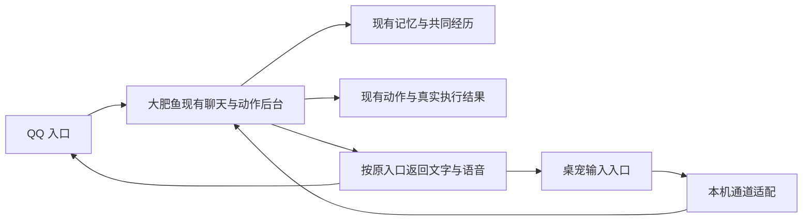

# 桌宠方案调研与接入方向

调研日期：2026-10-26。本页是方案，桌宠尚未接入本项目。

## 现成方案

| 方案 | 可参考或复用的部分 | 接入本项目的考虑 |
|---|---|---|
| [Open-LLM-VTuber Web](https://github.com/Open-LLM-VTuber/Open-LLM-VTuber-Web) | 独立 Web/Electron 前端、Live2D、桌宠窗口和语音播放交互 | 优先验证显示层与协议适配，不部署其另一套聊天、记忆或模型后端。它仍需适配，不能直接填相同 API Key 就认为已共用大脑。 |
| [AIRI](https://github.com/moeru-ai/airi) | Live2D/VRM 展示、眨眼与视线、桌面形态；仓库包含可复用的前端模块 | 可作为表现层参考，但项目覆盖面大，需要先验证模块依赖和构建成本。 |
| [VPet](https://github.com/LorisYounger/VPet) | Windows 桌面动作、拖动、互动与 MOD；提供 WPF 核心库及二次开发说明 | 适合重视走动和互动的路线；本项目当前是 Python + Vue，需要额外的 WPF 宿主或插件桥接。 |

项目自己的功能与素材许可应分别核对；引入 Live2D 时还需核对运行库、角色模型和动作的使用条件。现有表情包不是可以直接导入的 Live2D 模型，蓝发女仆形象需要相应模型或逐帧素材。

## 可看的 B 站演示

- [Open-LLM-VTuber 前端功能演示](https://www.bilibili.com/video/BV1rQAyeoEcZ/)：有桌面应用与桌宠演示分集。
- [Project AIRI 从零开始教程](https://www.bilibili.com/video/BV1HQdpBGEfU/)：可用于了解安装及表现形式。

以上核对了搜索可见的标题和介绍，未完整观看视频；实现和兼容性判断以项目源码及官方说明为准。[Open-LLM-VTuber 中文说明](https://github.com/Open-LLM-VTuber/Open-LLM-VTuber/blob/main/README.CN.md)注明正在规划 v2 重写，接入时应固定验证过的版本，不直接追随重构分支。

## 共用大肥鱼的大脑

桌宠只增加输入与显示入口，判断继续交给现有 Engine、聊天上下文、记忆、共同项目和动作执行流程。API Key、人设、记忆抽取和任务调度不放进桌宠前端。

桌面和 QQ 应映射到同一个主人身份与共同记录，同时保留来源通道。桌面输入由桌面显示回复，不额外发送一条 QQ；同一事项只登记一次。只在聊天窗口增加快捷键或填入相同模型地址，尚不能满足这些条件。

首阶段建议：可隐藏、可拖动的小窗口；显示当前真实任务与下一步；点击打开共同经历、日历或曲库。没有制作任务时显示休息，不能把未播放的歌曲标为“正在听”。状态刷新不调用语言模型。

之后再接桌面文字聊天、现有语音播放与口型、表情反馈。完成“QQ 聊一半，桌面继续，经历能找回，动作不重复”的验证后，再扩展主动互动。麦克风、截屏和复杂动作不作为首阶段的必要条件。
